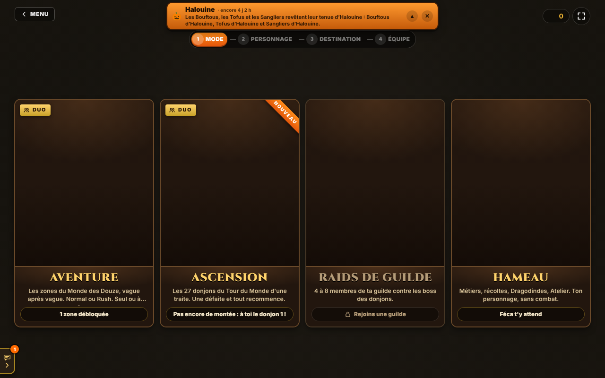
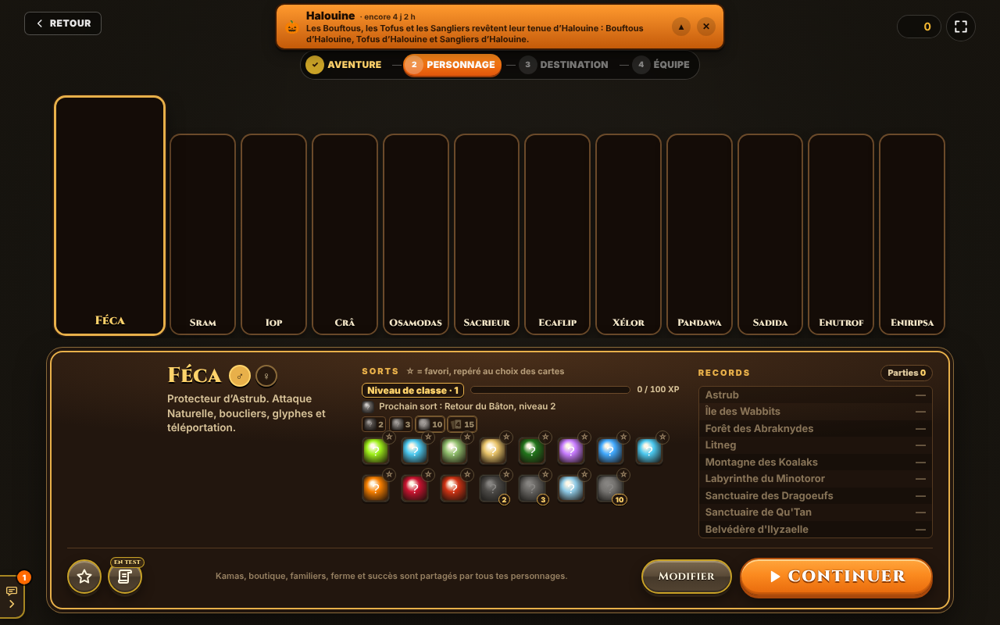
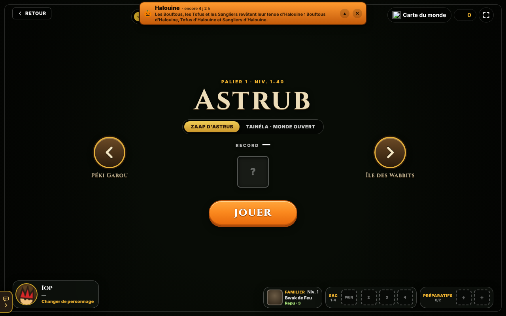
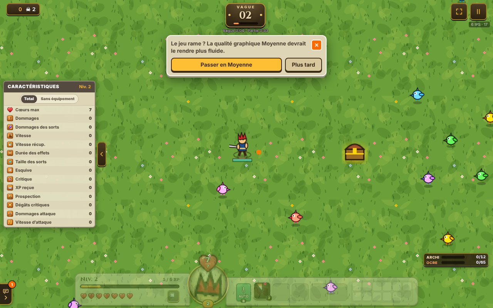
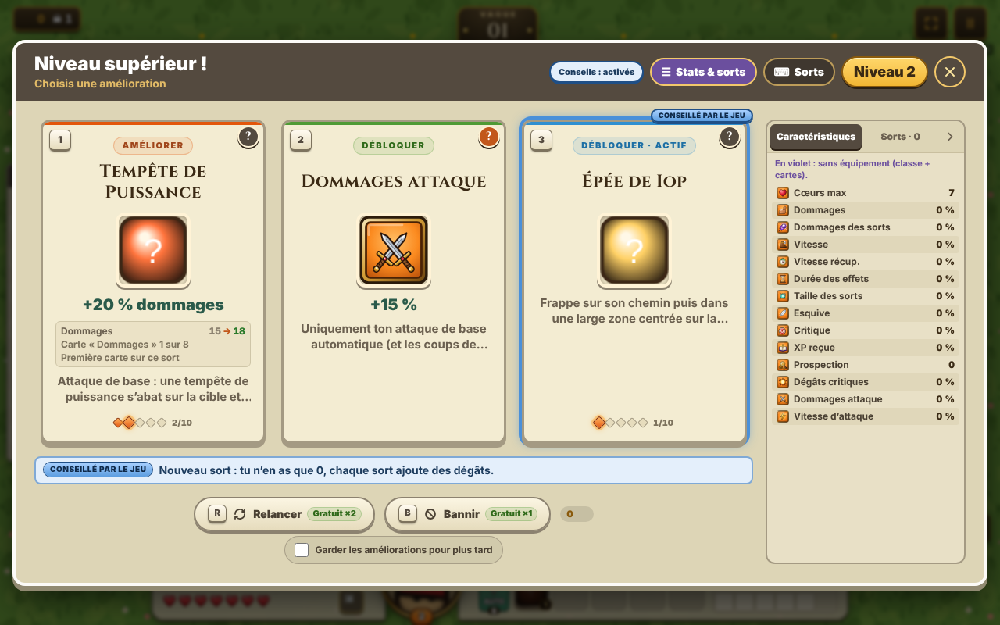

# Analyse de ZaapRush (zaaprush.online) et comparaison avec ZaapSurvie 2.0

Relevé du 29 octobre 2026, version **v1.21.74** du site. Deux sources :

1. **En jeu** : navigation dans le site avec un navigateur automatisé (Chromium sans affichage), en invité, sans créer de compte, puis une courte partie avec l'Iop à Astrub. Le moteur tournait à environ 6 images par seconde dans cet environnement, donc la partie s'arrête à la vague 2.
2. **Dans le code** : le site charge un fichier de données (`data-*.js`) et un moteur (`boot-*.js`). J'ai importé ces modules dans le navigateur et exporté leurs tables (classes, sorts, monstres, zones, boutique…) en JSON. Les chiffres ci-dessous en viennent.

Les images du jeu sont servies par `assets.zaaprush.online`, que la politique réseau de cet environnement bloque. Certaines icônes des menus manquent donc sur les captures. Les sprites en jeu, eux, se sont affichés.

## Ce qu'on voit en jouant

| Écran | Capture |
|---|---|
| Accueil → **JOUER** ouvre 4 modes : Aventure (solo ou duo), Ascension (les 27 donjons à la suite, une défaite et on recommence), Raids de guilde (4 à 8 joueurs), Hameau (métiers sans combat) |  |
| **Personnage** : les 12 classes sont jouables d'entrée, avec un genre ♂/♀. Chaque classe a 11 à 15 sorts débloqués par le « niveau de classe » (sorts au niv. 2, 3, 10, 15) et des records par zone |  |
| **Destination** : carrousel de zones (Astrub → Île des Wabbits → …), avec le choix « Zaap » (vagues) ou « Monde ouvert ». En bas : familier, sac (pain, potions) et 2 « préparatifs » |  |
| **Rythme** : *Normal* (une vague toutes les 22 s, classé), *Rush* (écran vidé → vague suivante, classement à part), *Tempo* (sans chrono, hors classement). Puis l'écran **Équipe** : seul ou avec un ami | — |
| **En jeu** : déplacement au **clic droit**, façon Dofus (le clavier ZQSD marche aussi), tutoriel en 7 étapes, PV en **cœurs** (7 pour l'Iop), barre de sorts, compteurs d'archimonstres et de « Dofus Ocre » |  |
| **Niveau supérieur** : 3 cartes (améliorer un sort / débloquer une stat / débloquer un sort actif), avec une carte « conseillée par le jeu », *Relancer* (×2 gratuits), *Bannir* (×1) et « Garder pour plus tard » |  |

Sur l'accueil : joueurs en ligne (~125), événements à durée limitée (Halouine, Razzia des Wabbits, événement de la semaine), streams en direct, classement, succès, familier, encyclopédie, wiki, guilde et builds de la communauté. Le jeu est en 3 langues (fr / en / es).

## Ce que dit le code

### Contenu

| | ZaapRush | ZaapSurvie 2.0 (nous) |
|---|---|---|
| Classes | 12 (Féca, Iop, Sram, Crâ, Osamodas, Sacrieur, Ecaflip, Xélor, Pandawa, Sadida, Enutrof, Eniripsa), toutes gratuites | 10 (3 à débloquer en kamas) |
| Sorts | 170 : 11 à 15 par classe + 4 partagés (Téléportation…) | 40 (4 par classe) |
| Améliorations de sort | Rangs jusqu'à 10 + 3 **branches** au choix par sort (ex. « Volée Fournie : +2 projectiles », « Rafale : −40 % recharge ») | 5 niveaux linéaires |
| Zones | 9, chacune avec un « palier » de niveaux : Astrub (1–40), Île des Wabbits (40–80), Forêt des Abraknydes (80–120), Litneg (120–160), Koalaks (160–200), Minotoror, Dragoeufs, Qu'Tan, Ilyzaelle (180–200). Une 10ᵉ annoncée (Péki Garou) | 5 |
| Monstres | 255 types (196 normaux, 56 boss), 7 comportements d'IA (poursuite, *hit and run*, etc.) | ~30 |
| Boss | Un boss final par zone (Bouftou Royal, Wa Wabbit, Chêne Mou, Meulou, Skeunk, Minotot, Crocabulia, Qu'Tan, Ilyzaelle) + boss récurrents (paramètres `every` de 6 à 12, probablement en vagues, avec un maximum de 2 à 4 apparitions) | 2 intermédiaires + 1 gardien par zone |
| Archimonstres | 65 (12 à Astrub), avec un nom propre (« Boufdégou le Refoulant »…) | Aucun |
| Dofus | 10 (Dofawa, Cawotte, Turquoise, Émeraude, Kaliptus, Pourpre, Vulbis, Ébène, Ivoire, Ocre), un par zone, + emplacements de Dofus achetables (50 k / 100 k / 300 k kamas) | 10 |
| Donjons | 27, du Donjon des Champs au Bworker (mode Ascension, 102 salles) | Aucun |

### Progression et systèmes

- **Vie en cœurs**, pas en PV : chaque coup retire un cœur, l'Iop en a 7, le Sacrieur +3 et une régénération propre (paramètre `regenEvery: 8`, unité non vérifiée).
- **Vagues infinies** : une vague toutes les 22 s en mode Normal. Les récompenses hebdomadaires sont fixées à la vague 50 / 100 / 150.
- **Statistiques en jeu** avec des gains dégressifs (ex. dommages +10 %, puis +9 %, +8,1 %…) et des plafonds (esquive 30 %, vitesse +25 %). Il y en a 15 : cœurs, dommages, dommages des sorts, dommages de l'attaque de base, vitesse d'attaque, critique, dégâts critiques, vitesse, esquive, récupération, durée des effets, taille des sorts, XP, prospection, invocations.
- **Attaque de base automatique** propre à chaque classe, plus des sorts actifs.
- **Boutique permanente** en 4 catégories : survie, puissance, fortune, métiers. 18 améliorations, de 5 à 10 rangs, débloquées par paliers.
- **Malédictions** facultatives (Pacte de sang : +40 % dommages, −1 cœur ; Verre fragile : +30 % critique…).
- **Marchand pendant la partie**, coffres, potions et pains (bonus de cœurs) à préparer avant de partir.
- **Familiers** (14 : Bwaks, Tofoudre, Écureuil, Chacha, Wabbit, Corbac…) qui attaquent, soignent ou ramassent ; ils ont faim et se nourrissent.
- **Hameau** : 6 métiers (paysan, alchimiste, bûcheron, mineur, pêcheur, éleveur), 125 recettes, élevage de **Dragodindes** (66 couleurs, croisements), ateliers et déco.
- **Équipement** : panoplies Dofus (Bouftou, Bouftou Royal, Bwork, Craqueleur légendaire, Dragon Cochon…), runes, parchemins de caractéristiques, objets d'apparence.
- **Social** : comptes en ligne, classements, coop en duo et raids de guilde (WebSocket), guildes avec niveaux et missions, succès, titres, quêtes quotidiennes et hebdomadaires, événements saisonniers.
- **Confort** : manette prise en charge, qualité graphique réglable (proposée automatiquement quand ça rame), mode plein écran, application installable (PWA).

### Graphismes

ZaapRush utilise les **sprites de Dofus Rétro**. Les données y font référence par identifiants Ankama (`retroId`, cartes et cellules Rétro), et les fichiers sont servis par `assets.zaaprush.online`. ZaapSurvie dessine tout en code, sans asset Ankama, comme indiqué dans le README.

## Ce qui serait le plus utile à reprendre dans ZaapSurvie

Ce sont des idées de conception à réimplémenter nous-mêmes, pas du code à copier. Par ordre d'impact estimé :

1. **Écran de niveau plus riche** : 3 cartes de natures différentes (améliorer / nouvelle stat / nouveau sort), plus *Relancer* et *Bannir*. C'est peu de code dans `ui.js` et ça change beaucoup les choix.
2. **Branches d'amélioration** : au rang max d'un sort, choisir 1 spécialisation parmi 3. Ça s'ajoute à notre format `up` de `data.js`.
3. **Rendements dégressifs et plafonds** sur les caractéristiques, pour éviter les builds cassés.
4. **Archimonstres** : variante rare, nommée et plus forte d'un monstre de la zone, avec un compteur de collection.
5. **Modes de rythme** (Normal / Rush / Tempo) : peu coûteux, puisque le minuteur de vagues existe déjà.
6. **Malédictions** facultatives avant la partie, en échange de plus de kamas.
7. Plus tard, et plus gros : familiers, pains et potions à préparer, puis donjons enchaînés (Ascension).

Le multijoueur, les comptes en ligne, les guildes et le Hameau demandent un serveur. Ils sortent du cadre d'un jeu statique comme le nôtre.
